<picture>
  <source media="(prefers-color-scheme: dark)" srcset="./assets/hero-dark.svg">
  <source media="(prefers-color-scheme: light)" srcset="./assets/hero-light.svg">
  
</picture>

# Alejandro Hernández Lara

**Senior Software Architect · Platform Engineering · Applied AI**

*I build the platforms engineering teams ship on, and the AI tooling that makes them faster.*

  
  
  
  

---

I design and build internal platforms and AI tooling for engineering teams: self-service infrastructure, ephemeral environments, and agents that run in production. I read a system end to end, from the database to the business outcome, and fix root causes instead of symptoms.

## Selected work

<table>
<tr>
<td width="50%" valign="top">

#### 🌱 Ephemeral environments, per merge request

Designed and built the core of an ephemeral-environments platform on GCP for a leading Latin American airline. Every merge request gets its own running environment, provisioned on demand and torn down automatically.

`Cloud Run` `Cloud SQL` `Terraform Cloud API` `Automatic DNS` `TTL cleanup`

</td>
<td width="50%" valign="top">

#### 🤖 A shared AI-agent workspace for a platform team

Built the Claude Code workspace a platform-engineering team works from: reusable agent skills, MCP servers, and CI quality gates. Recognized as the technical reference for generative AI on that engagement.

`Claude Code` `MCP` `Agent skills` `CI gates`

</td>
</tr>
<tr>
<td width="50%" valign="top">

#### 🔄 Self-service change data capture over MCP

Led the production rollout of an MCP server that lets teams set up PostgreSQL change data capture through self-service, with per-team authorization and audit logging.

`Python` `FastAPI` `PostgreSQL` `MCP`

</td>
<td width="50%" valign="top">

#### 🏦 Banking at national scale

Designed solution architecture for the mobile app and website of the bank with the most customers in Chile, and migrated the bank's email delivery to AWS SES.

`Solution architecture` `AWS` `AWS SES`

</td>
</tr>
</table>

## How I work

- **Diagnose first.** Read the code, the data, and the operations, and find the root cause before writing anything.
- **Plan, then review.** Non-trivial changes start as a reviewed plan and ship only after an independent review and green CI.
- **No deferred fixes.** No placeholders and no "later" TODOs; the docs match the system.

[Claude Code](https://claude.com/claude-code) is my primary environment: I orchestrate agents to design, build, modernize, and audit software with the same rigor.

## Stack

<table>
<tr>
<td><b>Cloud &amp; data</b></td>
<td>

</td>
</tr>
<tr>
<td><b>AI</b></td>
<td>

</td>
</tr>
<tr>
<td><b>Languages</b></td>
<td>

</td>
</tr>
<tr>
<td><b>Frameworks</b></td>
<td>

</td>
</tr>
</table>

For my own deployments I use **Railway**.

> Use referral code **`KJa0VN`** ([railway.com?referralCode=KJa0VN](https://railway.com?referralCode=KJa0VN)) and we both get credit.

## Activity

<picture>
  <source media="(prefers-color-scheme: dark)" srcset="https://raw.githubusercontent.com/Alejandrehl/alejandrehl/output/github-contribution-grid-snake-dark.svg">
  <source media="(prefers-color-scheme: light)" srcset="https://raw.githubusercontent.com/Alejandrehl/alejandrehl/output/github-contribution-grid-snake.svg">
  
</picture>

---

**Building something that has to work in production?** [Let's talk](mailto:alejandrehl@icloud.com) · [LinkedIn](https://www.linkedin.com/in/alejandrehl/)

*Zero tolerance for mediocrity.*

