<picture>
  <source media="(prefers-color-scheme: dark)" srcset="./assets/hero-dark.svg">
  <source media="(prefers-color-scheme: light)" srcset="./assets/hero-light.svg">
  
</picture>

# Alejandro Hernández&nbsp;Lara

**Senior&nbsp;Software&nbsp;Architect** 
Platform&nbsp;Engineering · Applied&nbsp;AI

*I build the platforms that engineering teams ship on, and the AI tooling they build with.*

[alehernandez.cl](https://www.alehernandez.cl) &nbsp;·&nbsp; [LinkedIn](https://www.linkedin.com/in/alejandrehl/) &nbsp;·&nbsp; [Email](mailto:alejandrehl@icloud.com)

I have shipped internal platforms, AI agent tooling, and solution architecture to production for a leading Latin American airline and for the bank with the most customers in Chile.

## Selected work

### Ephemeral environments, per merge&nbsp;request

<picture>
  <source media="(prefers-color-scheme: dark)" srcset="./assets/work-ephemeral-dark.svg">
  <source media="(prefers-color-scheme: light)" srcset="./assets/work-ephemeral-light.svg">
  
</picture>

Designed and built the core of an ephemeral-environments platform on GCP for a leading Latin American airline. Every merge request gets its own running environment, provisioned on demand and torn down automatically.

<code>GCP</code> <code>Cloud&nbsp;Run</code> <code>Cloud&nbsp;SQL</code> <code>Terraform&nbsp;Cloud&nbsp;API</code>

### A shared AI-agent workspace for a platform&nbsp;team

<picture>
  <source media="(prefers-color-scheme: dark)" srcset="./assets/work-agents-dark.svg">
  <source media="(prefers-color-scheme: light)" srcset="./assets/work-agents-light.svg">
  
</picture>

Built the Claude Code workspace a platform engineering team works from: reusable agent skills, MCP servers, and CI quality gates. I served as the technical reference for generative AI there.

<code>Claude&nbsp;Code</code> <code>MCP</code> <code>Agent&nbsp;Skills</code>

### Self-service change data capture over&nbsp;MCP

<picture>
  <source media="(prefers-color-scheme: dark)" srcset="./assets/work-cdc-dark.svg">
  <source media="(prefers-color-scheme: light)" srcset="./assets/work-cdc-light.svg">
  
</picture>

Led the production rollout of an MCP server that lets teams set up PostgreSQL change data capture through self-service, with per-team authorization and audit logging.

<code>Python</code> <code>FastAPI</code> <code>PostgreSQL</code> <code>MCP</code>

### Banking at national&nbsp;scale

<picture>
  <source media="(prefers-color-scheme: dark)" srcset="./assets/work-bank-dark.svg">
  <source media="(prefers-color-scheme: light)" srcset="./assets/work-bank-light.svg">
  
</picture>

Designed solution architecture for the mobile app and website of the bank with the most customers in Chile, and coordinated the migration of the bank's email delivery to Amazon SES.

<code>AWS</code> <code>Amazon&nbsp;SES</code>

## How I work

- **Diagnose first.** Find the root cause in the code, the data, and the operations before changing anything.
- **Plan, then review.** Non-trivial changes start as a reviewed plan and ship only after an independent review and green CI.
- **No deferred fixes.** No placeholders and no TODOs for later; the docs match the system.

[Claude Code](https://claude.com/claude-code) is my primary environment: I orchestrate agents to design, build, modernize, and audit software under these same three rules.

## Stack

<table>
<tr><td><b>Cloud &amp; data</b></td><td><code>GCP</code> <code>AWS</code> <code>Terraform</code> <code>Docker</code> <code>PostgreSQL</code> <code>MongoDB</code> <code>Railway</code></td></tr>
<tr><td><b>AI</b></td><td><code>Claude</code> <code>MCP</code></td></tr>
<tr><td><b>Languages</b></td><td><code>TypeScript</code> <code>Python</code> <code>Go</code> <code>PHP</code> <code>Dart</code></td></tr>
<tr><td><b>Frameworks</b></td><td><code>NestJS</code> <code>FastAPI</code> <code>Next.js</code> <code>React</code> <code>Laravel</code> <code>React&nbsp;Native</code> <code>Flutter</code></td></tr>
</table>

I deploy my own projects on **Railway**. Sign up with referral code **`KJa0VN`** at [railway.com](https://railway.com?referralCode=KJa0VN) and we both get credit.

## Activity

<picture>
  <source media="(prefers-color-scheme: dark)" srcset="https://raw.githubusercontent.com/Alejandrehl/alejandrehl/output/github-contribution-grid-snake-dark.svg">
  <source media="(prefers-color-scheme: light)" srcset="https://raw.githubusercontent.com/Alejandrehl/alejandrehl/output/github-contribution-grid-snake.svg">
  
</picture>

<picture>
  <source media="(prefers-color-scheme: dark)" srcset="./assets/cta-dark.svg">
  <source media="(prefers-color-scheme: light)" srcset="./assets/cta-light.svg">
  
</picture>

**[Let's talk](mailto:alejandrehl@icloud.com)** &nbsp;·&nbsp; [LinkedIn](https://www.linkedin.com/in/alejandrehl/)

*Zero tolerance for mediocrity.*

