<picture>
  <source media="(prefers-color-scheme: dark)" srcset="./assets/hero-dark.svg">
  <source media="(prefers-color-scheme: light)" srcset="./assets/hero-light.svg">
  
</picture>

# Alejandro&nbsp;Exequiel Hernández&nbsp;Lara

**Senior&nbsp;Software&nbsp;Architect** 
Platform&nbsp;Engineering · Applied&nbsp;AI

*I build the platforms that engineering teams ship on, and whole products, from the database to the app store.*

[alehernandez.cl](https://www.alehernandez.cl) &nbsp;·&nbsp; [LinkedIn](https://www.linkedin.com/in/alejandrehl/) &nbsp;·&nbsp; [Email](mailto:alejandrehl@icloud.com)

## Platform engineering

Internal platforms and AI agent tooling I built and shipped for a leading Latin American airline.

### Ephemeral environments per merge&nbsp;request

<picture>
  <source media="(prefers-color-scheme: dark)" srcset="./assets/work-ephemeral-dark.svg">
  <source media="(prefers-color-scheme: light)" srcset="./assets/work-ephemeral-light.svg">
  
</picture>

Designed and built the core of an ephemeral-environments platform on GCP. Every merge request gets its own running environment, provisioned on demand and torn down automatically.

<code>GCP</code> <code>Cloud&nbsp;Run</code> <code>Cloud&nbsp;SQL</code> <code>Terraform&nbsp;Cloud&nbsp;API</code>

### Shared AI agent workspace for a platform&nbsp;team

<picture>
  <source media="(prefers-color-scheme: dark)" srcset="./assets/work-agents-dark.svg">
  <source media="(prefers-color-scheme: light)" srcset="./assets/work-agents-light.svg">
  
</picture>

Built the Claude Code workspace a platform engineering team works from: reusable agent skills, MCP servers, and CI quality gates. I was also the person the team turned to for generative AI.

<code>Claude&nbsp;Code</code> <code>MCP</code> <code>Agent&nbsp;Skills</code>

### Self-service change data capture over&nbsp;MCP

<picture>
  <source media="(prefers-color-scheme: dark)" srcset="./assets/work-cdc-dark.svg">
  <source media="(prefers-color-scheme: light)" srcset="./assets/work-cdc-light.svg">
  
</picture>

Led the production rollout of an MCP server that lets teams enable PostgreSQL change data capture on their own, with per-team authorization and audit logging.

<code>Python</code> <code>FastAPI</code> <code>PostgreSQL</code> <code>MCP</code>

## Products

Apps and systems I built or co-built, for clients and for myself.

### Mobile apps on both&nbsp;stores

<picture>
  <source media="(prefers-color-scheme: dark)" srcset="./assets/work-mobile-dark.svg">
  <source media="(prefers-color-scheme: light)" srcset="./assets/work-mobile-light.svg">
  
</picture>

**NutriCoach** is a nutrition and training tracker I built as its sole developer: snap a meal and it gets logged, and an optional coaching chat runs on Claude. [App&nbsp;Store](https://apps.apple.com/cl/app/nutricoach-calor%C3%ADas-y-entreno/id6790234920) · [Google&nbsp;Play](https://play.google.com/store/apps/details?id=cl.nutricoach.app)

<code>React&nbsp;Native</code> <code>Expo</code> <code>NestJS</code> <code>Prisma</code> <code>Claude&nbsp;API</code>

For an **art marketplace**, I was the main author of its Flutter app and co-authored its API and web front ends.

<code>Flutter</code> <code>Dart</code>

### Production ERP for a distribution&nbsp;company

<picture>
  <source media="(prefers-color-scheme: dark)" srcset="./assets/work-erp-dark.svg">
  <source media="(prefers-color-scheme: light)" srcset="./assets/work-erp-light.svg">
  
</picture>

Sales, inventory, customers, suppliers, payments, seller commissions, and delivery notes for a Chilean distribution company, in production with a coverage gate and its test suite running in CI.

<code>Laravel</code> <code>Filament</code> <code>MySQL</code> <code>Railway</code>

### micodigopostal.fun

<picture>
  <source media="(prefers-color-scheme: dark)" srcset="./assets/work-postal-dark.svg">
  <source media="(prefers-color-scheme: light)" srcset="./assets/work-postal-light.svg">
  
</picture>

A side project that went live: look up any Chilean postal code by municipality or street address, with a public API. [micodigopostal.fun](https://micodigopostal.fun)

<code>Astro</code> <code>NestJS</code> <code>Prisma</code> <code>PostgreSQL</code> <code>Railway</code>

## Stack

- <b>AI</b> &nbsp; <code>Claude&nbsp;API</code> <code>Claude&nbsp;Code</code> <code>MCP</code> <code>Agent&nbsp;Skills</code>
- <b>Languages</b> &nbsp; <code>TypeScript</code> <code>Python</code> <code>PHP</code> <code>Dart</code> <code>Go</code>
- <b>Frameworks</b> &nbsp; <code>NestJS</code> <code>FastAPI</code> <code>Next.js</code> <code>Astro</code> <code>React&nbsp;Native</code> <code>Expo</code> <code>Flutter</code> <code>Laravel</code> <code>Filament</code>
- <b>Cloud &amp; data</b> &nbsp; <code>GCP</code> <code>AWS</code> <code>Terraform</code> <code>Docker</code> <code>PostgreSQL</code> <code>MySQL</code> <code>MongoDB</code> <code>Railway</code>

I deploy my own projects on **Railway**. Sign up through [my referral link](https://railway.com?referralCode=KJa0VN) (code **`KJa0VN`**) and you get Railway credits.

## Activity

<picture>
  <source media="(prefers-color-scheme: dark)" srcset="https://raw.githubusercontent.com/Alejandrehl/alejandrehl/output/github-contribution-grid-snake-dark.svg">
  <source media="(prefers-color-scheme: light)" srcset="https://raw.githubusercontent.com/Alejandrehl/alejandrehl/output/github-contribution-grid-snake.svg">
  
</picture>

<picture>
  <source media="(prefers-color-scheme: dark)" srcset="./assets/cta-dark.svg">
  <source media="(prefers-color-scheme: light)" srcset="./assets/cta-light.svg">
  
</picture>

**[Let's talk](mailto:alejandrehl@icloud.com)** &nbsp;·&nbsp; [LinkedIn](https://www.linkedin.com/in/alejandrehl/)

*Zero tolerance for mediocrity.*

