# Alejandro Hernández Lara

**Senior Software Architect · Platform Engineering · Applied AI**

*I diagnose before I build — then I ship production systems that scale.*

  
  
  
  
  

---

I design and build software where **architecture meets operations**: cloud-native platforms, developer self-service and AI agents running in production at enterprise scale. Years at the intersection of engineering and business operations taught me to read a system as a single piece — from the database to the P&L — and to fix the cause, not the symptom.

### 🏗️ Selected work

- **Ephemeral environments, per merge request** — designed and built the core of an ephemeral-environments platform on GCP for a leading Latin American airline: Cloud Run, Cloud SQL, Terraform Cloud workspaces driven by API, automatic DNS and TTL-based cleanup.
- **An AI-agent command center** — created the command center a platform-engineering team works from: agent skills, MCP servers and CI quality gates, run with strict engineering rigor.
- **Self-service data streaming over MCP** — led the production rollout of an MCP server for self-service PostgreSQL change data capture, with per-squad authorization and auditing.
- **Banking at national scale** — designed architecture solutions shipped in the mobile app and website of the bank with the most customers in Chile, and migrated its email delivery to AWS SES.
- **Generative AI, applied** — the go-to technical reference for generative AI on an enterprise engagement: agents, MCP and AI-assisted engineering in regulated, high-stakes environments.

> 🔭 **Focus:** software architecture, platform engineering, developer self-service and AI agents in production.

### 🛠️ Tech I work with

### ⚡ How I build

**[Claude Code](https://claude.com/claude-code)** is my primary environment — I orchestrate agents to design, build, modernize and audit software under tight engineering rigor: plans reviewed before execution and independent reviews before shipping. Most of what I ship runs on **Railway**.

> Deploying on Railway? Use my referral code **`KJa0VN`** ([railway.com?referralCode=KJa0VN](https://railway.com?referralCode=KJa0VN)) — we both get credit.

### 📊 GitHub

<picture>
  <source media="(prefers-color-scheme: dark)" srcset="https://raw.githubusercontent.com/Alejandrehl/alejandrehl/output/github-contribution-grid-snake-dark.svg">
  <source media="(prefers-color-scheme: light)" srcset="https://raw.githubusercontent.com/Alejandrehl/alejandrehl/output/github-contribution-grid-snake.svg">
  
</picture>

---

*Zero tolerance for mediocrity. Diagnose before you build. Ship.*

